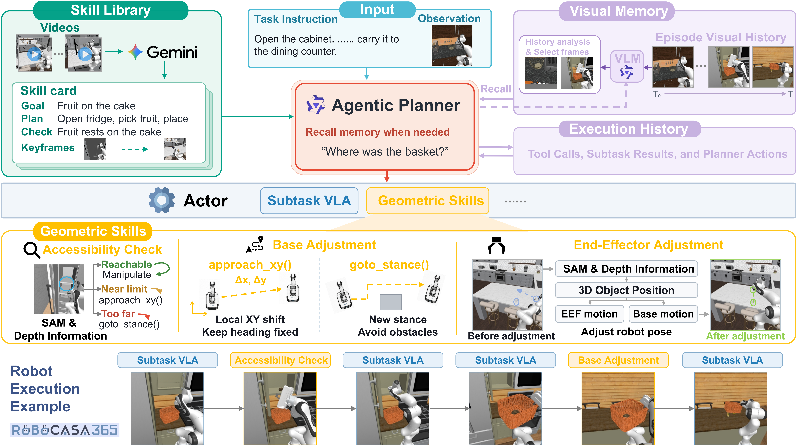
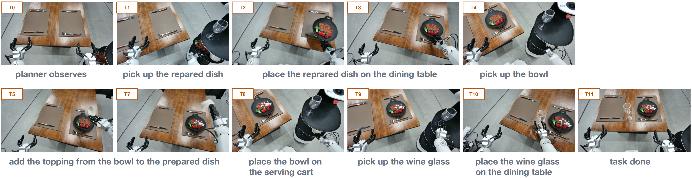

<div align="center">

# Cracking Mobile Manipulation

### From Failure Diagnosis to Agentic Robot System

**Why do strong local manipulation policies fail when deployed in long-horizon mobile manipulation, and which interventions help most?**

<p>
  <a href="./paper.pdf">
    
  </a>
  <a href="#-release-status">
    
  </a>
</p>

</div>

## 🧭 Release

🚧 **Coming soon.** We plan to release the following components:

- [ ] **Subtask VLA training code** — Training scripts and configurations for subtask vla.
- [ ] **Subtask VLA evaluation** — Evaluation scripts and benchmark configurations for subtask vla.
- [ ] **Subtask VLA checkpoint** 
- [ ] **Agentic robot system** — High-level planner, skill library, adaptive visual memory, and geometric adjustment tools.
- [ ] **System evaluation** — Task definitions, evaluation scripts, and episode seeds for long-horizon mobile manipulation.
- [ ] **Setup and reproduction guide** — Environment setup and instructions for running the released components.


## Overview

Vision-language-action (VLA) models can execute local manipulation task, but coordinating those skills across changing viewpoints, robot base poses, and multiple workspaces remains challenging. In our evaluation, a pretrained subtask VLA reaches **80%** success on atomic RoboCasa365 tasks, while an agentic system built on that VLA succeeds on only **19%** of long-horizon mobile-manipulation episodes. We study **where** failures occur and use that diagnosis to decide **which capabilities to add**. Our failure-guided agentic framework augments a fixed subtask VLA with in-context planning guidance, adaptive visual recall, and geometric adjustment.

**Main contributions**

- 🔎 **A systematic failure diagnosis of mobile manipulation.** We analyze the gap between strong subtask-level manipulation and long-horizon mobile manipulation, identifying three dominant failure regimes: task planning, navigation and base positioning, and local manipulation. The analysis turns overall success gap into a concrete, stage-wise failure structure.
- 🧩 **A failure-guided agentic intervention framework.** Based on the diagnosed bottlenecks, we introduce targeted interventions around a fixed subtask VLA, including demonstration-based planning guidance, adaptive visual memory, accessibility-aware base adjustment, and local end-effector adjustment. 
- 📈 **Agentic intervention consistently improves the performance of mobile manipulation.** The proposed interventions improve the success rate from 19.0\% to 47.0\% on RoboCasa365. Our experiments further demonstrate consistent gains on held-out RoboCasa365 episodes, BEHAVIOR-1K tasks, and a real dual-arm mobile manipulator. 


## 🔍 Where Does Mobile Manipulation Fail?

We study **20 mobile-manipulation tasks** selected from the **composite tasks** in RoboCasa365. The agentic baseline achieves **19/100** successful episodes on the development seeds, leaving **81 baseline failures**. The breakdown below is **the share of those 81 failures**.

<p align="center">
  
</p>

**Finding 1**: Task planning fails when task progress is not tracked reliably.

**Finding 2**: Reaching the correct workspace does not guarantee a suitable base pose for manipulation.

**Finding 3**: Precise manipulation can still fail after planning and navigation succeed.


## 🛠️ Failure-Guided Agentic Framework

<p align="center">
  
</p>

Guided by the above failure analysis, we keep the subtask VLA fixed and add failure-guided interventions at the bottlenecks. These interventions provide demonstration-based planning guidance, adaptive visual memory, an accessibility check with base adjustment, and local end-effector adjustment. 


## 🧪 Benchmarks & Evaluation

| Setting | Evaluation protocol | Purpose |
|:--|:--|:--|
| **RoboCasa365 — development** | 20 mobile-manipulation tasks × 5 matched episodes = **100 trials** | Failure diagnosis and progressive integration |
| **RoboCasa365 — held-out** | Same 20 tasks × 5 **separate seeds** = **100 trials** | Evaluate the finalized design on different initial scene |
| **BEHAVIOR-1K** | 5 long-horizon tasks, **100 trials** | Evaluate transfer of the agentic system design |
| **Real robot** | Astribot-S1, 2 tasks × 10 trials = **20 trials** | Test closed-loop task completion on real-robot |


## 📊 Results

### Progressive integration on RoboCasa365

Each row **adds one component** to the configuration directly above it; all configurations are evaluated on the same 100 development episodes.

| System configuration | Success / 100 | Success rate |
|:--|--:|--:|
| Agentic baseline | 19 | 19% |
| + Demonstration-based skill library | 25 | 25% |
| + Adaptive visual memory | 29 | 29% |
| + Accessibility-aware base adjustment | 40 | 40% |
| **+ Local end-effector adjustment (full system)** | **47** | **47%** |


### Development and held-out performance

| Method | Development success (%) | Held-out success (%) |
|:--|--:|--:|
| Agentic baseline (adapted from Harness VLA) | 19 | 18 |
| **Ours — full system** | **47** | **49** |

The held-out evaluation is conducted only after fixing the system design, prompts, and tool parameters. Its matched comparison shows **18% → 49%** success rate on different scene and object initializations.

### Transfer beyond RoboCasa365

| Evaluation | Agentic baseline | Full system |
|:--|--:|--:|
| **BEHAVIOR-1K** (5 tasks, 100 trials) | 14% | **37%** |
| **Real mobile manipulator** (2 tasks, 20 trials) | 5/20 | **13/20** |

On the real robot, the two tasks are **Storage Box Transport** (2/10 → 6/10) and **Table Service** (3/10 → 7/10). A representative Table Service rollout is shown below.

<p align="center">
  
</p>


## 📚 Citation

If you find this project useful, please cite:

```bibtex
@misc{wang2026crackingmobilemanipulation,
  title  = {Cracking Mobile Manipulation: From Failure Diagnosis to Agentic Robot System},
  author = {Zixuan Wang and Jia-Ning Li and Yinzhou Tang and Yanzhao Yu and Biao Wu and Meng Fang and Xin Li and Yiwu Zhong},
  year   = {2026},
  note   = {Preprint}
}
```

---

## 🙏 Acknowledgements

Our experiments build on open research infrastructure including **RoboCasa365**, **BEHAVIOR-1K**, and pretrained **vision-language-action** policies. The agentic baseline is adapted from **Harness VLA**. We thank the authors and maintainers of the tools and benchmarks that support mobile manipulation research; please see the [paper](./paper.pdf) for detailed references.

